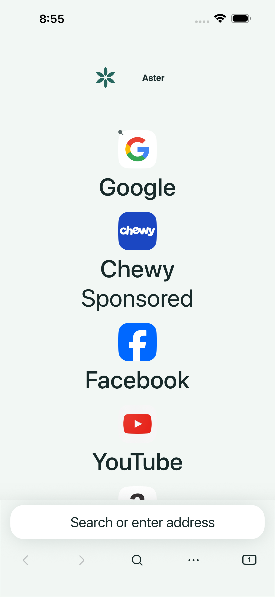

# Actual Aster simulator captures

These unmodified screenshots come from [GitHub run 38083870485](https://github.com/omarkebrit/-HarborBrowser-/actions/runs/38083870485), source `51fe284ead04c0d17b55c51725aa590dd951d031`, on an iPhone 15 Pro Max simulator running iOS 26.5. These are actual test fixtures and UI, not design mockups.

In the depicted run, the preflight passed all four cases and the main selection passed 14/15; its immediate post-rotation toolbar assertion failed. The newer [run 38393771825](https://github.com/omarkebrit/-HarborBrowser-/actions/runs/38393771825) has now passed all four preflight cases, including 25-tab creation/restoration, and preserved its evidence checkpoint. Its full unit plan is running; main UI, download and device build remain pending. These images retain their original source provenance and do not certify signed installation, every website, complete Arabic translation or physical-device audio. See [the validation report](../../TEST-REPORT.md).

| Capture | Image |
| --- | --- |
| Light browser chrome at large text | [View](light-browser.png) |
| Dark browser chrome; fixture page stays light | [View](dark-browser.png) |
| Maximum Dynamic Type homepage with StageServer sponsored test tiles | [View](accessibility-home.png) |
| Arabic locale: right-aligned tab tray; translation remains partial | [View](arabic-tab-tray.png) |
| Controlled private-storage fixture | [View](private-storage.png) |
| Decoded MP4 fixture with sound enabled; no device-audio claim | [View](mp4-playback.png) |
| First tab after process relaunch; 25 tabs retained | [View](restored-25-tabs.png) |
| Real portrait fullscreen playback | [View](fullscreen-portrait.png) |
| Real landscape fullscreen playback | [View](fullscreen-landscape.png) |
| Browser after fullscreen exit in the passing preflight invocation | [View](fullscreen-preflight-exit.png) |

[manifest.json](manifest.json) records each original XCTest attachment filename, owning test and SHA-256. The PNG bytes were copied without editing.
