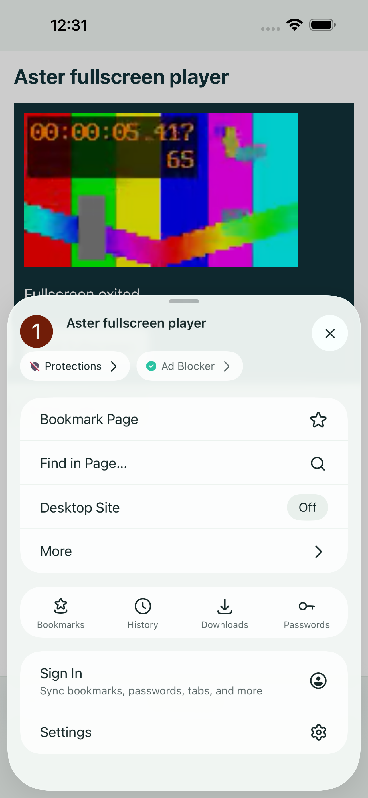

# Run 15 preflight captures

These unmodified screenshots come from [GitHub run 38393771825](https://github.com/omarkebrit/-HarborBrowser-/actions/runs/38393771825), source `aab3dc3ac23bf2e58c1334920fe70528e9dad527`, on an iPhone 15 Pro Max simulator running iOS 26.5. They show actual native UI and local test fixtures.

All four preflight tests passed, with no failures or skips. At publication, the full unit plan was running; the main UI suite, isolated download verification, and unsigned device build were pending. This gallery documents simulator behavior; signed installation and physical-device testing are unverified. See [the validation report](../../../TEST-REPORT.md) for current results.

| Capture | Image |
| --- | --- |
| Real portrait fullscreen playback | [View](fullscreen-portrait.png) |
| Real landscape fullscreen playback | [View](fullscreen-landscape.png) |
| Native browser controls restored after fullscreen exit | [View](fullscreen-preflight-exit.png) |
| Native browser menu opened after fullscreen exit | [View](fullscreen-return-menu.png) |
| First tab after process relaunch; 25 tabs retained | [View](restored-25-tabs.png) |

[manifest.json](manifest.json) records the source commit, run, artifact `11813987465`, original XCTest attachments, owning tests, and SHA-256 values. Every PNG was copied without editing. The [original gallery](../README.md) retains its separate source provenance.
