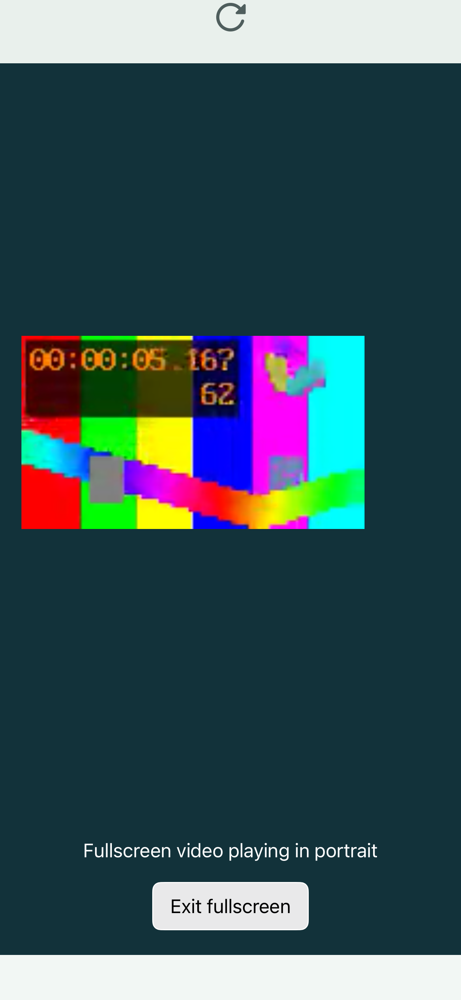
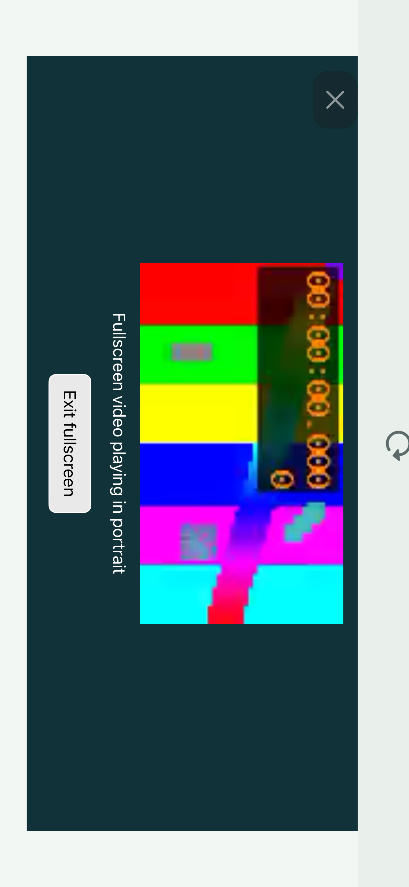

# Run 17 fullscreen failure evidence

These unmodified files come from [run 17, attempt 1](https://github.com/omarkebrit/-HarborBrowser-/actions/runs/38410673448), job `115341845594`, artifact `11823414971`, source `6d8eec264d4eaafea4eaed6bd2ff919e0005f7f8`. The device was an iPhone 15 Pro Max simulator running iOS 26.5 (23F77), built with Xcode 26.5 (17F42).

The official preflight result is **3 passed, 1 failed, 0 skipped, 0 expected failures**. The failing case is `AsterAcceptanceTests/testElementFullscreenKeepsPlayingAcrossRotationAndExits()`, with `Missing rendered media text: Fullscreen video playing in landscape`. Popup playback, restrictive autoplay and 25-tab creation/restoration passed in that run.

| Capture | Observation |
| --- | --- |
| [Portrait fullscreen](FD223A04-5350-431B-BF7B-AB3F9D7F6F55.png) | Burned-in media time 5.167 seconds, frame 62 |
| [Failed landscape fullscreen](C468925B-5E87-420E-9DF2-9F29B4371FE0.png) | Burned-in media time 0.000 seconds, frame 0; the page retains its previous portrait-playing label |

The [native accessibility hierarchy](5B8FEAC6-4252-4CF6-8496-4AA796B81062.txt) records a landscape window and a media value of zero seconds. The separately reviewed native recording showed the frame staying frozen after rotation at the loop boundary; these two still images alone do not establish its duration or cause. No video or result bundle is copied here.

The [official summary](AsterRegressionTests-summary.json), [recorded source](source-commit.txt) and [manifest with exact file SHA-256 hashes](manifest.json) preserve provenance. This is failure evidence for the recorded source, not proof of a playback fix, a passing current build, signed installation or physical-device behavior.
