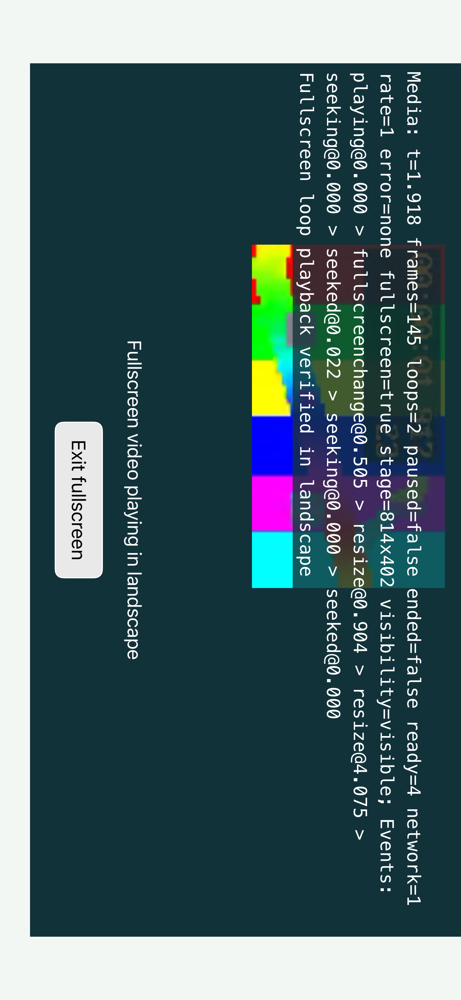
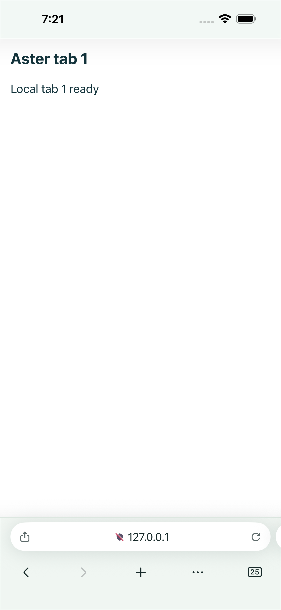

# Run 18 preflight checkpoint

These unmodified files come from [run 18, attempt 1](https://github.com/omarkebrit/-HarborBrowser-/actions/runs/39379658275), job `118485608884`, checkpoint artifact `12247766739` (122,240,494 bytes), source `7788245534fc23c00a93fb8375c83ebce8703a1e`. The environment was an iPhone 15 Pro Max simulator running iOS 26.5 (23F77), with Xcode 26.5 (17F42).

The official preflight result is **4 passed, 0 failed, 0 skipped, 0 expected failures**. Popup playback, restrictive autoplay, fullscreen playback/exit/native interaction, and 25-tab creation/restoration passed. The fullscreen case requires two landscape end/start transitions plus fresh decoded frames. Its JavaScript diagnostics are read-only. The Client native probe was compiled out because this build lacked the Swift `DEBUG` flag, so these captures do not establish native probe execution. Rotation was recorded at media time 4.075 seconds in the six-second clip; the two later landscape transitions do not test rotation coincident with run 17's first-loop boundary. Production playback behavior was unchanged, and this pass does not establish the cause or a fix for that stall.

| Capture | Owning case |
| --- | --- |
| [Decoded frames after two landscape loops](5A898014-16BB-4B19-A1BE-63CAEB12314A.png) | `testElementFullscreenKeepsPlayingAcrossRotationAndExits()` |
| [Restored first page with 25 tabs](2B754D89-CF91-4F68-BA0A-6DAB9E467BD6.png) | `testTwentyFiveTabsSurviveProcessRelaunch()` |

The [official summary](AsterRegressionTests-summary.json), [recorded source](source-commit.txt) and [manifest with exact file SHA-256 hashes and attachment names](manifest.json) preserve source-bound provenance. No videos or result bundles are copied here.

This is a partial checkpoint. At publication, the full unit stage had failed with diagnosis pending final logs, the main UI selection was running, and download/device-package results remained pending. No production IPA or full-validation pass exists. These simulator captures do not certify physical-device playback, signed installation or every website.
